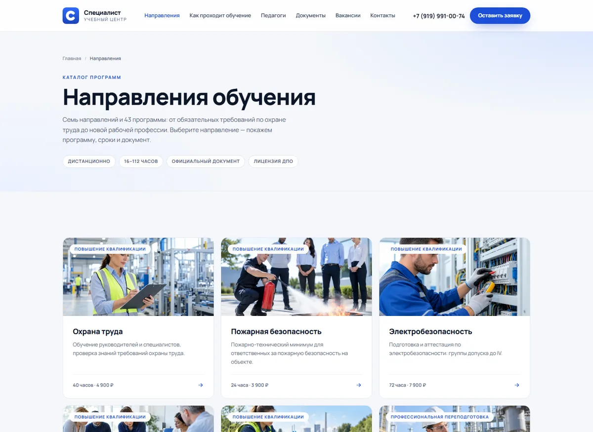
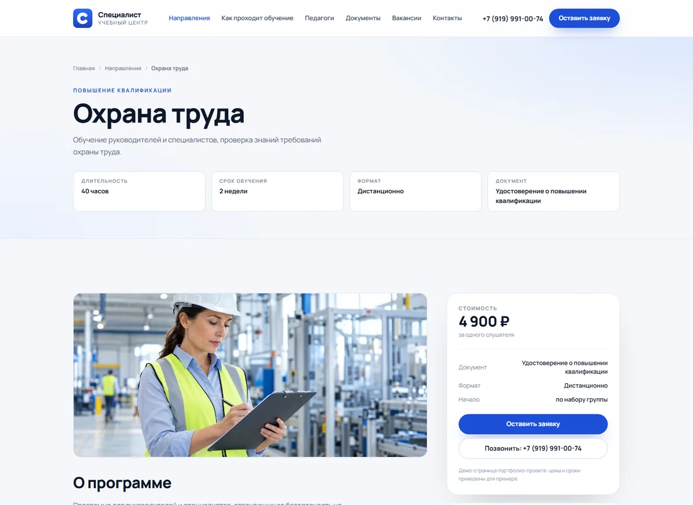
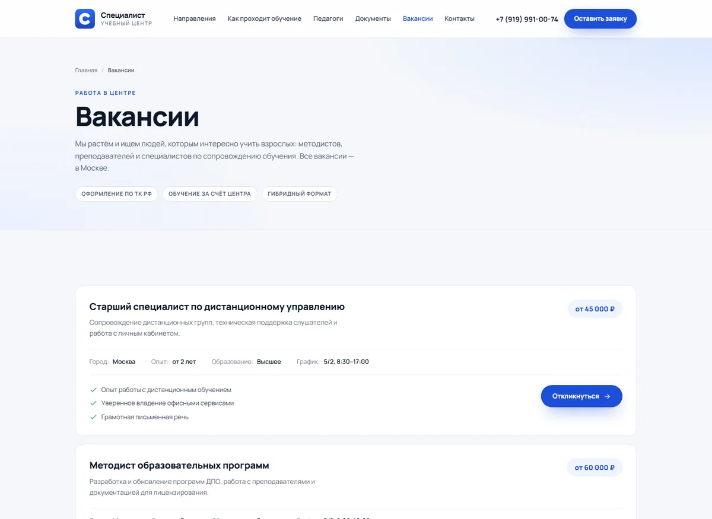
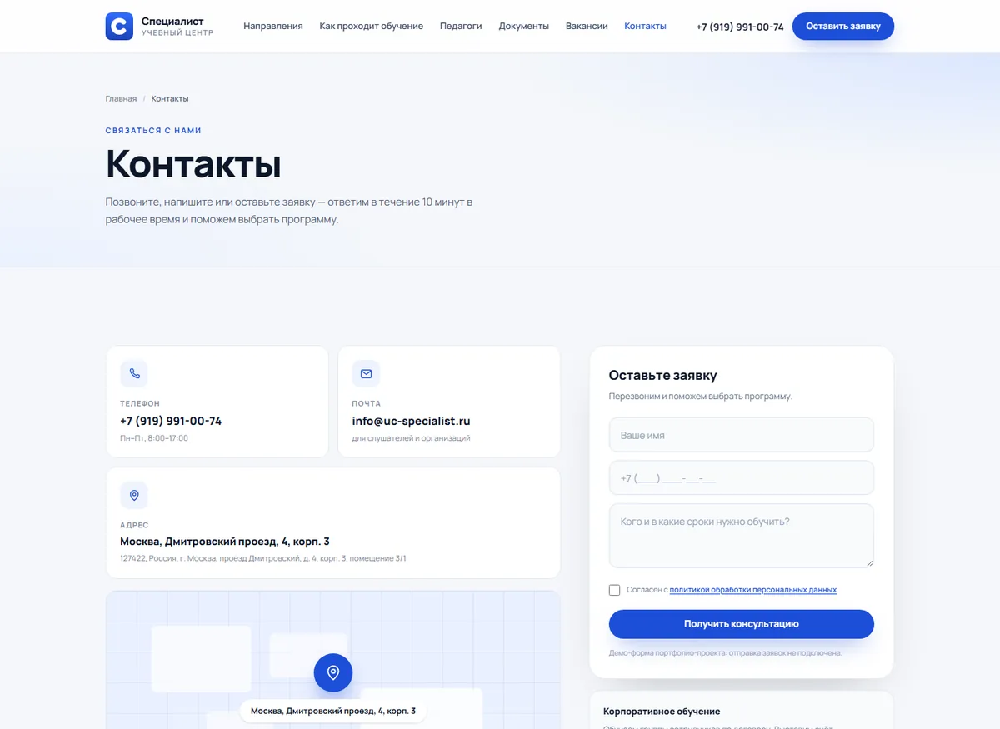
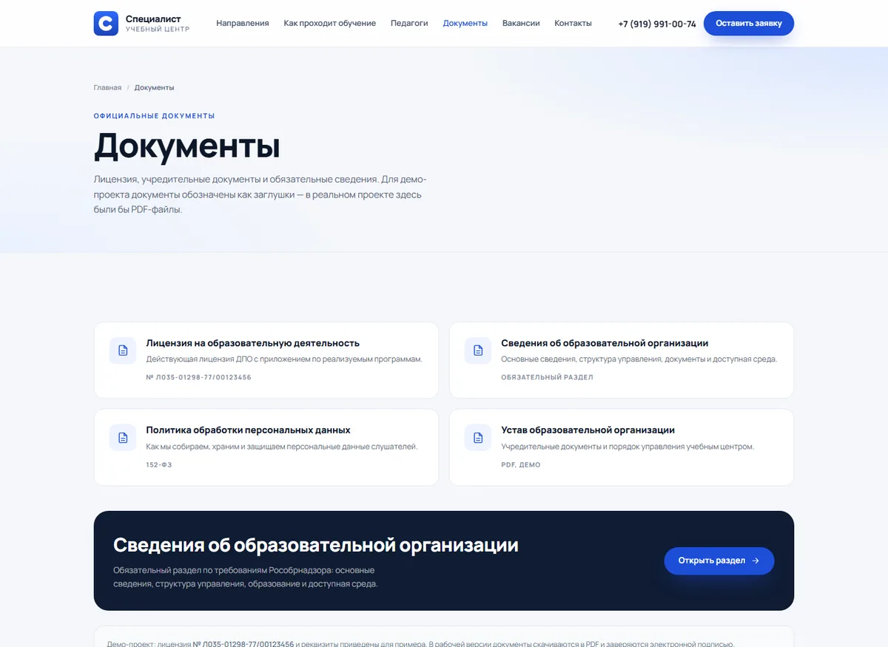
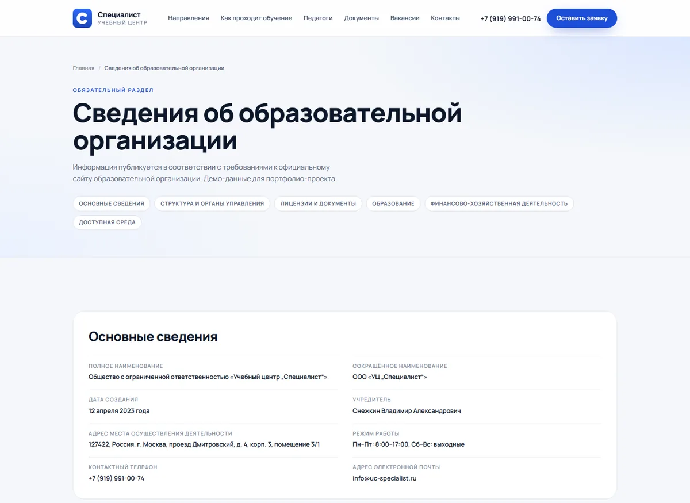
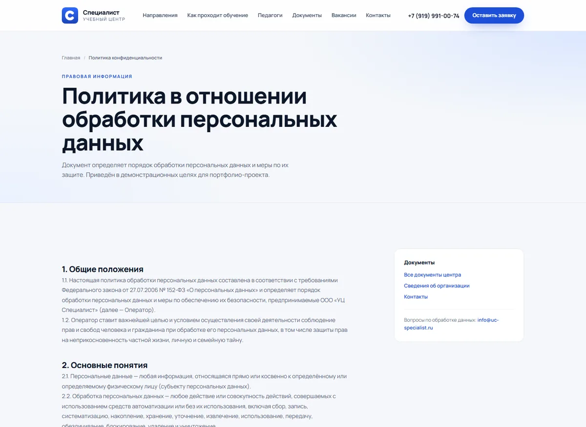
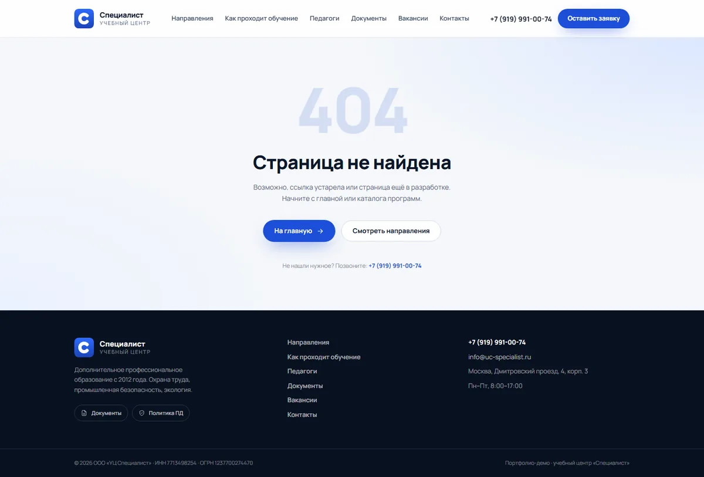
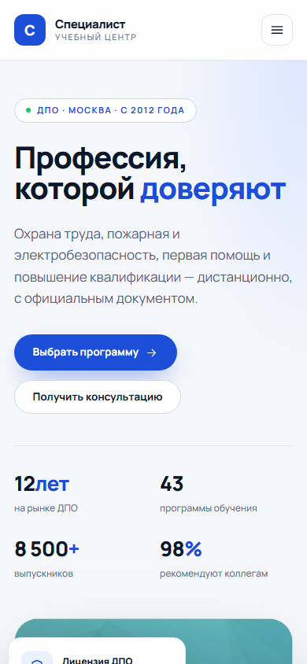

<div align="center">

# Учебный центр «Специалист»

**Архив сайта 2023 года и его современный перезапуск на Astro**

[](https://astro.build)
[](https://www.typescriptlang.org)
[](https://tailwindcss.com)
[](https://nodejs.org)
[](#статус)

[Новая версия](#быстрый-старт) · [Скриншоты](#скриншоты) · [Архив 2023](#архив-2023) · [Деплой](#деплой)

</div>

---

Сайт учебного центра дополнительного профессионального образования: 7 направлений
обучения, карточки программ, вакансии, документы и сведения об организации.

В репозитории живут две версии — современная и архивная.

| Версия | Стек | Где |
| :-- | :-- | :-- |
| 🚀 **Новая** (перезапуск) | Astro 5 · TypeScript · Tailwind CSS 4 | [`site/`](site/) |
| 🗄️ **Архивная** (2023) | Gulp-шаблон, HTML + include-компоненты | корень репозитория |

Живая демо-версия: **[trainingcenter-1rbj-alexmerfs-projects.vercel.app](https://trainingcenter-1rbj-alexmerfs-projects.vercel.app)**

> [!IMPORTANT]
> Это портфолио-демо. Реквизиты, цены, документы и часть контента — примеры.
> Отправка форм не подключена: все заявки остаются в браузере.

## Скриншоты

Первый экран страниц новой версии. Полные снимки (1440px, вся высота страницы) —
в [`shots/`](shots/), компактные превью — в [`shots/preview/`](shots/preview/).


<p align="center">
  
  
</p>

<details>
<summary>Ещё страницы: вакансии, контакты, документы, мобильная версия</summary>

<br>

<p align="center">
  
  
</p>

<p align="center">
  
  
</p>

<p align="center">
  
  
</p>

<p align="center">
  
</p>

</details>

## Быстрый старт

```bash
cd site          # новая версия
pnpm install
pnpm dev         # http://localhost:4321
```

Сборка и проверки:

```bash
pnpm build       # статическая сборка в site/dist/
pnpm preview     # локальный просмотр собранного сайта
pnpm typecheck   # astro check
```

## Страницы

| Маршрут | Содержимое |
| :-- | :-- |
| `/` | Главная: hero, направления, преимущества, процесс, педагоги, документы |
| `/directions/` | Каталог из 7 направлений |
| `/directions/[slug]/` | Карточка программы: модули, результаты, стоимость |
| `/jobs/` | Вакансии |
| `/contacts/` | Контакты, схематичная карта, реквизиты, форма |
| `/documents/` | Лицензия и документы |
| `/info-organization/` | Сведения об образовательной организации |
| `/politic/` | Политика обработки персональных данных |
| `404` | Страница ошибки |
| `/robots.txt`, `/sitemap.xml` | Генерируются автоматически |

## Что реализовано

- **Доступность** — панель «Версия для слабовидящих» (размер шрифта, межбуквенное
  расстояние, контраст, скрытие изображений) с сохранением настроек в `localStorage`,
  семантическая разметка и `aria`-атрибуты, фокус-стили, `prefers-reduced-motion`.
- **SEO** — уникальные `title`/`description`, canonical, Open Graph, JSON-LD
  (`EducationalOrganization`, `Course`, `ItemList`), `sitemap.xml`, `robots.txt`.
- **Адаптив** — сетки и типографика от 320px, мобильное меню, полноэкранные макеты.
- **Контент отдельно от кода** — всё в [`site/src/data/content.ts`](site/src/data/content.ts):
  новая программа или вакансия добавляется одним объектом, страницы создаются автоматически.

## Структура репозитория

```
Trainingcenter/
├── site/                  # новая версия: Astro 5 + TypeScript + Tailwind CSS 4
│   ├── src/               # компоненты, контент, лейаут, страницы, стили
│   ├── public/            # изображения, фавиконы, site.webmanifest
│   ├── tools/             # обработка картинок, фавиконы, скриншоты, smoke-тест
│   └── docs/              # промты для генерации изображений
├── shots/                 # полные скриншоты страниц и превью для README
├── incoming/              # исходники картинок (в .gitignore)
├── pages/                 # HTML-исходники архива с include-директивами
├── components/            # 18 переиспользуемых блоков архива
├── css/  js/  images/     # минифицированные бандлы и картинки архива
└── *.html                 # собранные страницы архива
```

## Архив 2023

Первый сайт собран в июне 2023 года на Gulp-шаблоне: страницы + include-компоненты.
Сборщик в репозитории не сохранился, поэтому архив лежит в исходном виде, без изменений.

| Файл | Назначение |
| :-- | :-- |
| `index.html`, `directions.html`, `jobs-page.html`, `contacts-page.html`<br>`info-organization.html`, `politic.html`, `404.html` | Собранные страницы |
| `pages/` | HTML-исходники с директивами `<!--=include ...-->` |
| `components/` | 18 include-блоков (header, footer, menu, формы и др.) |
| `css/style.min.css`, `js/main.min.js` | Минифицированные бандлы |
| `images/` | Изображения и SVG-иконки |

> Архивные страницы — статический HTML: откройте `index.html` в браузере, чтобы
> посмотреть, как выглядел сайт до перезапуска.

## Деплой

Новая версия задеплоена на Vercel: **Root Directory** = `site`, Framework = Astro,
Node.js 22.x. Пуш в `main` автоматически запускает production-деплой.

Подробности — в [`site/README.md`](site/README.md#деплой-на-vercel).

## Статус

Портфолио-демо. Формы демонстрационные (отправка не подключена), реквизиты, цены и
документы — примеры. Использовать как основу реального сайта можно после подключения
бэкенда форм, реальных документов и контента.

---

<div align="center">
<sub>Архив 2023 · Перезапуск 2026</sub>
</div>
